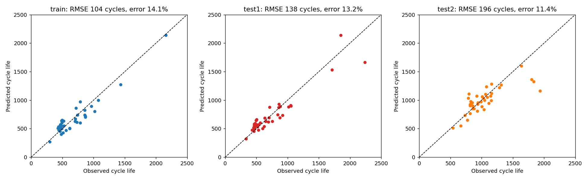

# Predicting Lithium-Ion Battery Cycle Life from the First 100 Cycles
 

 
Predicts how many charge–discharge cycles a lithium-ion cell will last, using only its first 100 cycles.
The project re-implements the ΔQ(V) variance model of Severson et al. (2019) on the processed arrays
released by Attia et al. (2021), then adds baselines, a data-quality check and a "how early is early
enough?" analysis.
 
## Headline results (RMSE in cycles, lower is better)
 
| Model | Training cells | Primary test | Secondary test |
|---|---|---|---|
| Predict the average (baseline) | 327.2 | 398.8 | 510.6 |
| Capacity fade only | 290.9 | 357.8 | 450.7 |
| **ΔQ variance (1 feature)** | **103.6** | **138.4** | **196.0** |
| ΔQ statistics (5 features) | 99.9 | 127.5 | 204.4 |
| Random forest (5 features) | 79.0 | 165.8 | 228.0 |
 
The secondary test is a separate, later batch of cells, so it is the more honest estimate.
Primary-test numbers leave out one cell (life 148 cycles), following the paper; including it changes
the variance model's RMSE from 138.4 to 138.0.
 

 
## Data
124 commercial LFP/graphite cells (41 training, 43 primary test, 40 secondary test) cycled under fast
charging. The notebook uses the Q(V) arrays for cycles 2-100 and the cycle lives published at
https://github.com/petermattia/revisit-severson-et-al (MIT licence), generated from the original dataset
https://data.matr.io/1/projects/5c48dd2bc625d700019f3204 (check its licence terms before reuse).
The notebook downloads the data automatically; it is not stored in this repository.
 
## Method
1. ΔQ(V) = Q(V) at cycle 100 minus Q(V) at cycle 10
2. Feature: log10 of the variance of ΔQ(V) across voltage
3. Model: elastic net with 5-fold cross-validation on the training cells only; target = log10(cycle life)
 
## Findings
- Capacity alone is nearly uninformative in the first 100 cycles.
- One ΔQ feature cuts the error to about a third of the baseline (training and primary test).
- Extra features and a random forest do not generalise better to the secondary test.
- Predictions are clearly better than the baseline by about cycle 40 (secondary-test RMSE 236 vs 511),
  but the trend is noisy because only 41 cells train the model.
 
## Data quality
Seven cells have corrupt Q(V) curves at cycles 12, 13, 73 or 74. None affects the cycles the model
uses (10, 20, ..., 100).
 
## Limitations
One cell type (LFP/graphite), one dataset, 124 cells from one lab. Training and primary-test cells come
from the same batches. Only ΔQ(V) features are used; the original paper's best models use more.
 
## How to run
Click the Open in Colab button above and choose Runtime > Run all. Packages: see requirements.txt.
 
## AI assistance
The code and text were drafted with the help of an AI assistant (Claude). I ran the notebook in Google
Colab and checked that its results reproduce the reference values for the paper's variance model.
[EDIT: add here what you personally did, in one or two true sentences.]
 
## References
1. Severson, Attia et al., Nature Energy 4, 383-391 (2019). https://doi.org/10.1038/s41560-019-0356-8
2. Attia et al., Journal of The Electrochemical Society (2021). https://doi.org/10.1149/1945-7111/ac2704

